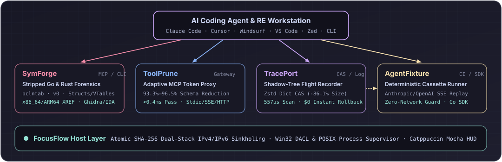
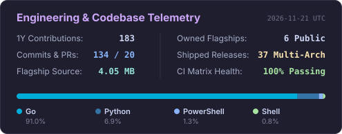

<div align="center">
  <a href="https://github.com/aloneangel45">
    
  </a>
</div>

<br/>

<p align="center">
  <a href="https://github.com/aloneangel45/MCPGate/releases/latest"></a>
  <a href="https://github.com/aloneangel45/SymForge/releases/latest"></a>
  <a href="https://github.com/aloneangel45/toolprune/releases/latest"></a>
  <a href="https://github.com/aloneangel45/traceport/releases/latest"></a>
  <a href="https://github.com/aloneangel45/AgentFixture/releases/latest"></a>
  <a href="https://github.com/aloneangel45/FocusFlow/releases/latest"></a>
  <a href="https://x.com/aloneangel20_1"></a>
</p>

---

### Flagship Open-Source Suite

Zero-bloat, `CGO_ENABLED=0` developer infrastructure built for **zero-trust MCP security**, **stripped binary forensics**, **MCP context optimization**, **deterministic workspace checkpointing**, **offline agent CI**, and **deep-work discipline**:

| Project | Domain | Engineering Highlights | CI | Stack |
| :--- | :--- | :--- | :---: | :---: |
| **[MCPGate](https://github.com/aloneangel45/MCPGate)** | **Zero-Trust OS Sandbox & Egress DLP Firewall** | Wraps any MCP server/agent with Win32 Job/Landlock/Seatbelt containment, HTTP/HTTPS `CONNECT` egress firewall + SSRF/IMDS & `.env` DLP blocking, SHA-256 rug-pull locks, circuit breakers, OWASP MCP Top 10 SARIF/HTML audits, and read-only MCP server. | [](https://github.com/aloneangel45/MCPGate/actions/workflows/ci.yml) | `Go` `Security` `MCP` |
| **[SymForge](https://github.com/aloneangel45/SymForge)** | **Stripped Go & Rust Binary Forensics + MCP** | Pure-Go `ELF`/`PE`/`Mach-O` + Fat `--arch` loader with native IAT/Dylib imports, Go 1.2–1.27+ `pclntab`/`abi.Type` & Rust `v0`/vtable recovery, binary `diff`, `scan` (`garble`/IoC triage), BFS `path` + DOT/Mermaid graphs, Ghidra/IDA/Binja scripts, and 11-tool MCP server. | [](https://github.com/aloneangel45/SymForge/actions/workflows/ci.yml) | `Go` `Rust RE` `MCP` |
| **[ToolPrune](https://github.com/aloneangel45/toolprune)** | **Adaptive MCP Proxy, Security Guard & Token Gateway** | Progressive `--max-schema-tokens` & `--max-response-tokens` pruning (**93.3%–96.5%** reduction at **<0.4ms**), SHA-256 rug-pull lock & tool-poisoning guard, `audit --all-ides` (SARIF 2.1.0), and live `top`/Prometheus telemetry across `stdio`, `SSE`, and `/mcp`. | [](https://github.com/aloneangel45/toolprune/actions/workflows/ci.yml) | `Go` `MCP` `JSON-RPC` |
| **[TracePort](https://github.com/aloneangel45/traceport)** | **Zstd Shadow-Tree, Flight Recorder & Self-Healing MCP** | Content-addressable Zstd shadow-tree checkpointing (**86.1% footprint reduction**), native redacted `traceport mcp` + IDE `preset`, interactive dark-mode HTML timeline export, and `.gitignore`-aware `traceport watch` for **$0 zero-token rollback**. | [](https://github.com/aloneangel45/traceport/actions/workflows/ci.yml) | `Go` `Zstd` `MCP` |
| **[AgentFixture](https://github.com/aloneangel45/AgentFixture)** | **Deterministic $0 CI/CD & Chaos Cassette Runner** | Anthropic/OpenAI/Gemini SSE + MCP `stdio` replay, deterministic chaos injection (`429`/`529`/SSE drop), hybrid `--record-mode new_episodes`, USD/token/prompt-cache budgets + `$GITHUB_STEP_SUMMARY`, and parallel `agentfixture test` suite runner. | [](https://github.com/aloneangel45/AgentFixture/actions/workflows/ci.yml) | `Go` `SSE` `CI/CD` |
| **[FocusFlow](https://github.com/aloneangel45/FocusFlow)** | **Deep Work Discipline Engine & Desktop HUD** | Unified Go CLI & zero-dependency Python Catppuccin Mocha HUD with SHA-256 dual-stack IPv4/IPv6 `hosts` sinkholing, recurring `schedule` daemon, 90-day contribution heatmap, native OS notifications, and privilege-hardened lifecycle hooks. | [](https://github.com/aloneangel45/FocusFlow/actions/workflows/ci.yml) | `Go` `Python` `Win32` |

<details>
<summary><strong>⚡ Quick-Install One-Liners (Linux / macOS / Windows / Go)</strong></summary>

```bash
# MCPGate — Zero-Trust OS Sandbox & Egress DLP Firewall for MCP
curl -fsSL https://raw.githubusercontent.com/aloneangel45/MCPGate/main/install.sh | sh

# SymForge — Stripped Go & Rust Binary Forensics + MCP Server
curl -fsSL https://raw.githubusercontent.com/aloneangel45/SymForge/main/install.sh | sh

# ToolPrune — Adaptive MCP Token-Budget Proxy & Security Guard
curl -fsSL https://raw.githubusercontent.com/aloneangel45/toolprune/main/install.sh | sh

# TracePort — Zstd Shadow-Tree Flight Recorder & Self-Healing MCP
curl -fsSL https://raw.githubusercontent.com/aloneangel45/traceport/main/install.sh | sh

# AgentFixture — Deterministic SSE, Chaos & MCP Cassette Runner
curl -fsSL https://raw.githubusercontent.com/aloneangel45/AgentFixture/main/install.sh | sh
```

```powershell
# Windows PowerShell (Zero-Module .NET SHA-256 Verified Installers)
irm https://raw.githubusercontent.com/aloneangel45/MCPGate/main/install.ps1 | iex
irm https://raw.githubusercontent.com/aloneangel45/SymForge/main/install.ps1 | iex
irm https://raw.githubusercontent.com/aloneangel45/toolprune/main/install.ps1 | iex
irm https://raw.githubusercontent.com/aloneangel45/traceport/main/install.ps1 | iex
irm https://raw.githubusercontent.com/aloneangel45/AgentFixture/main/install.ps1 | iex
```

</details>

---

### Ecosystem Architecture

<div align="center">
  
</div>

---

### Systems & Reverse Engineering Stack

- **Languages & Toolchains:** `Go` (`CGO_ENABLED=0` static multi-arch), `Rust`, `Python`, `C/C++`, `TypeScript`, `POSIX Shell` & `.NET PowerShell`
- **Binary Analysis & RE:** `ELF` / `PE` (`.pdata` unwind) / `Mach-O` (`LC_DYLD_CHAINED_FIXUPS` & `arm64e` PAC), Go `pclntab` & `abi.Type`, Rust RFC 2603 `v0` demangling & trait vtables, pure-Go `x86_64` & `ARM64` XREF graphs, Ghidra / IDA Pro / Binary Ninja scripting
- **Agentic Protocols & Runtime:** Model Context Protocol (`MCP` over `stdio` NDJSON/`Content-Length`, SSE & Streamable HTTP), JSON-RPC 2.0 batching, Anthropic/OpenAI SSE stream replay, `cl100k_base` token budgeting
- **Storage & OS Internals:** Dictionary-trained Zstandard (`Zstd`) CAS, crash-safe write-ahead journals, SHA-256 integrity gates, Win32 (`Toolhelp32`, `ReplaceFileW` DACLs) & POSIX process supervision

---

### Live Telemetry & Activity

<p align="center">
  <a href="https://github.com/aloneangel45?tab=repositories">
    
  </a>
  <a href="https://github.com/aloneangel45">
    
  </a>
</p>

---

<p align="center">
  <em>"Build with zero bloat, verify with zero mocks, engineer for deterministic resilience."</em><br/>
  <sub>Crafted by <strong>Arda</strong> (<a href="https://github.com/aloneangel45">@aloneangel45</a>) · <a href="https://x.com/aloneangel20_1">@aloneangel20_1</a></sub>
</p>
