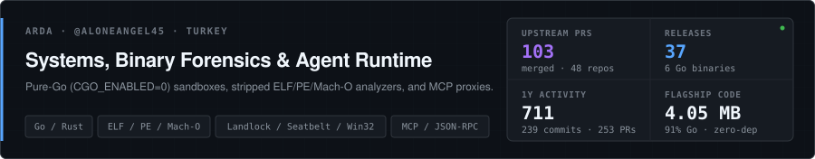
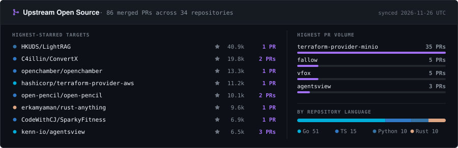
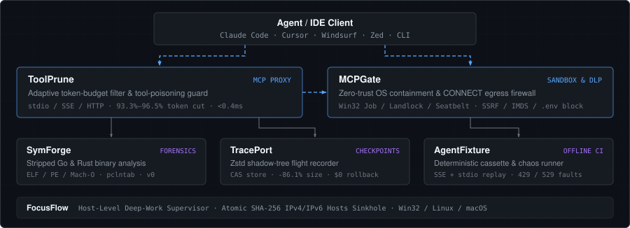

<a href="https://github.com/aloneangel45">
  <picture>
    <source media="(prefers-color-scheme: dark)" srcset="./assets/header-dark.svg"/>
    <source media="(prefers-color-scheme: light)" srcset="./assets/header-light.svg"/>
    
  </picture>
</a>

<p align="right">
  <sub>
    <a href="https://github.com/aloneangel45?tab=repositories&amp;type=source">repositories</a>
    &nbsp;·&nbsp;
    <a href="https://github.com/pulls?q=is%3Apr+author%3Aaloneangel45+is%3Amerged+-user%3Aaloneangel45">merged PRs (<!-- sync:merged_prs_count -->119<!-- /sync:merged_prs_count -->)</a>
    &nbsp;·&nbsp;
    <a href="https://x.com/aloneangel20_1">x/@aloneangel20_1</a>
  </sub>
</p>

### Systems &amp; Tooling

<table width="100%">
  <tr>
    <td width="50%" valign="top">
      <strong><a href="https://github.com/aloneangel45/SymForge">SymForge</a></strong> &nbsp;<code><!-- sync:SymForge_tag -->v1.1.1<!-- /sync:SymForge_tag --></code><br/>
      Stripped Go &amp; Rust binary forensics without external debuggers. Pure-Go <code>ELF</code> / <code>PE</code> / <code>Mach-O</code> loader with <code>pclntab</code>, <code>abi.Type</code>, Rust <code>v0</code> vtable recovery, <code>garble</code> triage, x86_64/ARM64 XREF graphs, and an 11-tool MCP server.<br/>
      <sub><a href="https://github.com/aloneangel45/SymForge/releases/latest">release</a> · <a href="https://github.com/aloneangel45/SymForge/actions/workflows/ci.yml">ci</a> · <code>CGO_ENABLED=0</code> · <!-- sync:SymForge_rels -->4<!-- /sync:SymForge_rels --> releases</sub>
    </td>
    <td width="50%" valign="top">
      <strong><a href="https://github.com/aloneangel45/MCPGate">MCPGate</a></strong> &nbsp;<code><!-- sync:MCPGate_tag -->v1.0.1<!-- /sync:MCPGate_tag --></code><br/>
      Zero-trust OS sandbox and egress DLP firewall for MCP servers. Enforces Win32 Job Objects, Linux Landlock, and macOS Seatbelt alongside HTTP/HTTPS <code>CONNECT</code> SSRF/IMDS filtering, <code>.env</code> leak blocking, and SHA-256 rug-pull locks.<br/>
      <sub><a href="https://github.com/aloneangel45/MCPGate/releases/latest">release</a> · <a href="https://github.com/aloneangel45/MCPGate/actions/workflows/ci.yml">ci</a> · <code>CGO_ENABLED=0</code> · <!-- sync:MCPGate_rels -->2<!-- /sync:MCPGate_rels --> releases</sub>
    </td>
  </tr>
  <tr>
    <td width="50%" valign="top">
      <strong><a href="https://github.com/aloneangel45/toolprune">ToolPrune</a></strong> &nbsp;<code><!-- sync:toolprune_tag -->v1.4.1<!-- /sync:toolprune_tag --></code><br/>
      Adaptive MCP token-budget proxy and multi-upstream gateway across <code>stdio</code>, <code>SSE</code>, and Streamable HTTP. Cuts tool schema &amp; payload overhead by <strong>93.3%–96.5%</strong> at <strong>&lt;0.4ms</strong> while auditing IDEs to SARIF 2.1.0.<br/>
      <sub><a href="https://github.com/aloneangel45/toolprune/releases/latest">release</a> · <a href="https://github.com/aloneangel45/toolprune/actions/workflows/ci.yml">ci</a> · <code>CGO_ENABLED=0</code> · <!-- sync:toolprune_rels -->9<!-- /sync:toolprune_rels --> releases</sub>
    </td>
    <td width="50%" valign="top">
      <strong><a href="https://github.com/aloneangel45/traceport">TracePort</a></strong> &nbsp;<code><!-- sync:traceport_tag -->v1.3.1<!-- /sync:traceport_tag --></code><br/>
      Content-addressable Zstd dictionary shadow-tree flight recorder for coding agents. Compresses workspace snapshots by <strong>86.1%</strong> and exposes redacted MCP checkpoints for zero-token rollback.<br/>
      <sub><a href="https://github.com/aloneangel45/traceport/releases/latest">release</a> · <a href="https://github.com/aloneangel45/traceport/actions/workflows/ci.yml">ci</a> · <code>CGO_ENABLED=0</code> · <!-- sync:traceport_rels -->7<!-- /sync:traceport_rels --> releases</sub>
    </td>
  </tr>
  <tr>
    <td width="50%" valign="top">
      <strong><a href="https://github.com/aloneangel45/AgentFixture">AgentFixture</a></strong> &nbsp;<code><!-- sync:AgentFixture_tag -->v1.3.1<!-- /sync:AgentFixture_tag --></code><br/>
      Deterministic offline CI/CD cassette runner for AI agents. Replays Anthropic/OpenAI/Gemini SSE streams and MCP <code>stdio</code> with fault injection (<code>429</code>/<code>529</code>/stream drops), token/USD budgets, and <code>$GITHUB_STEP_SUMMARY</code> gates.<br/>
      <sub><a href="https://github.com/aloneangel45/AgentFixture/releases/latest">release</a> · <a href="https://github.com/aloneangel45/AgentFixture/actions/workflows/ci.yml">ci</a> · <code>CGO_ENABLED=0</code> · <!-- sync:AgentFixture_rels -->7<!-- /sync:AgentFixture_rels --> releases</sub>
    </td>
    <td width="50%" valign="top">
      <strong><a href="https://github.com/aloneangel45/FocusFlow">FocusFlow</a></strong> &nbsp;<code><!-- sync:FocusFlow_tag -->v2.3.1<!-- /sync:FocusFlow_tag --></code><br/>
      Cross-platform deep-work supervisor and desktop HUD. Combines atomic SHA-256 dual-stack IPv4/IPv6 <code>hosts</code> sinkholing with Win32/Linux/macOS process enforcement and recurring schedule daemons.<br/>
      <sub><a href="https://github.com/aloneangel45/FocusFlow/releases/latest">release</a> · <a href="https://github.com/aloneangel45/FocusFlow/actions/workflows/ci.yml">ci</a> · <code>CGO_ENABLED=0</code> · <!-- sync:FocusFlow_rels -->8<!-- /sync:FocusFlow_rels --> releases</sub>
    </td>
  </tr>
</table>

### Upstream Open Source

<!-- sync:merged_prs_count -->119<!-- /sync:merged_prs_count --> merged pull requests across <!-- sync:distinct_repos_count -->58<!-- /sync:distinct_repos_count --> external repositories in Go, Rust, TypeScript, and Python.

<a href="https://github.com/pulls?q=is%3Apr+author%3Aaloneangel45+is%3Amerged+-user%3Aaloneangel45">
  <picture>
    <source media="(prefers-color-scheme: dark)" srcset="./assets/upstream-dark.svg"/>
    <source media="(prefers-color-scheme: light)" srcset="./assets/upstream-light.svg"/>
    
  </picture>
</a>

| Repository | Stack | Merged Work |
| :--- | :---: | :--- |
| [hashicorp/terraform-provider-aws](https://github.com/hashicorp/terraform-provider-aws) | `Go` | [`#51355`](https://github.com/hashicorp/terraform-provider-aws/pull/51355) Treat zero event hold duration as absent in `aws_s3_object` RawConfig |
| [apache/arrow-rs](https://github.com/apache/arrow-rs) | `Rust` | [`#12410`](https://github.com/apache/arrow-rs/pull/12410) Strip trailing bytes in `FixedSizeBinaryArray` construction |
| [HKUDS/LightRAG](https://github.com/HKUDS/LightRAG) | `Python` | [`#4536`](https://github.com/HKUDS/LightRAG/pull/4536) Re-raise original exception after exhausted NVIDIA retries |
| [version-fox/vfox](https://github.com/version-fox/vfox) | `Go` | [`#832`](https://github.com/version-fox/vfox/pull/832) Path traversal validation on SDK names, exec flag passthrough, download isolation (5 PRs) |
| [fallow-rs/fallow](https://github.com/fallow-rs/fallow) | `Rust` | [`#5179`](https://github.com/fallow-rs/fallow/pull/5179) Svelte/Astro AST extraction fixes &amp; VS Code dry-run preview (5 PRs) |
| [kenn-io/agentsview](https://github.com/kenn-io/agentsview) | `Go` | [`#3370`](https://github.com/kenn-io/agentsview/pull/3370) Anthropic tool_result image normalization &amp; remote-sync resilience (3 PRs) |
| [C4illin/ConvertX](https://github.com/C4illin/ConvertX) | `TypeScript` | [`#723`](https://github.com/C4illin/ConvertX/pull/723) Multi-output job progress unblocking &amp; converter target normalization (2 PRs) |
| [aminueza/terraform-provider-minio](https://github.com/aminueza/terraform-provider-minio) | `Go` | [35 PRs](https://github.com/aminueza/terraform-provider-minio/pulls?q=is%3Apr+author%3Aaloneangel45+is%3Amerged) IAM, S3 object locking, replication validation, import state, and `errcheck` hardening |

### Architecture

<picture>
  <source media="(prefers-color-scheme: dark)" srcset="./assets/architecture-dark.svg"/>
  <source media="(prefers-color-scheme: light)" srcset="./assets/architecture-light.svg"/>
  
</picture>

<details>
<summary><strong>Quick install (Linux / macOS / Windows)</strong></summary>

```sh
curl -fsSL https://raw.githubusercontent.com/aloneangel45/MCPGate/main/install.sh | sh       # Zero-trust MCP OS sandbox & egress DLP
curl -fsSL https://raw.githubusercontent.com/aloneangel45/SymForge/main/install.sh | sh      # Stripped Go & Rust binary forensics
curl -fsSL https://raw.githubusercontent.com/aloneangel45/toolprune/main/install.sh | sh     # Adaptive MCP token-budget proxy
curl -fsSL https://raw.githubusercontent.com/aloneangel45/traceport/main/install.sh | sh     # Zstd shadow-tree flight recorder
curl -fsSL https://raw.githubusercontent.com/aloneangel45/AgentFixture/main/install.sh | sh  # Deterministic SSE & MCP cassette runner
```

```powershell
irm https://raw.githubusercontent.com/aloneangel45/MCPGate/main/install.ps1 | iex       # MCPGate (SHA-256 verified)
irm https://raw.githubusercontent.com/aloneangel45/SymForge/main/install.ps1 | iex      # SymForge (SHA-256 verified)
irm https://raw.githubusercontent.com/aloneangel45/toolprune/main/install.ps1 | iex     # ToolPrune (SHA-256 verified)
irm https://raw.githubusercontent.com/aloneangel45/traceport/main/install.ps1 | iex     # TracePort (SHA-256 verified)
irm https://raw.githubusercontent.com/aloneangel45/AgentFixture/main/install.ps1 | iex  # AgentFixture (SHA-256 verified)
```

</details>

<details>
<summary><strong>Technical focus &amp; internals</strong></summary>

| Domain | Stack &amp; Internals |
| :--- | :--- |
| **Languages** | `Go` (`CGO_ENABLED=0` static multi-arch), `Rust`, `TypeScript`, `Python`, `POSIX Shell`, `PowerShell` |
| **Binary Forensics** | `ELF`, `PE` (`.pdata` unwind, IAT), `Mach-O` (`LC_DYLD_CHAINED_FIXUPS`, `arm64e` PAC), Go `pclntab` / `abi.Type`, Rust `v0` demangling &amp; vtables, `x86_64` / `ARM64` XREFs, Ghidra / IDA / Binary Ninja scripts |
| **Protocols &amp; Runtime** | `MCP` (`stdio` NDJSON / `Content-Length`, `SSE`, Streamable HTTP), `JSON-RPC 2.0`, Anthropic/OpenAI/Gemini SSE replay, `cl100k_base` token budgeting |
| **OS &amp; Storage** | Win32 Job Objects / `Toolhelp32` / `ReplaceFileW`, Linux Landlock, macOS Seatbelt, Zstd dictionary CAS, WAL journals, SHA-256 integrity gates |

</details>
